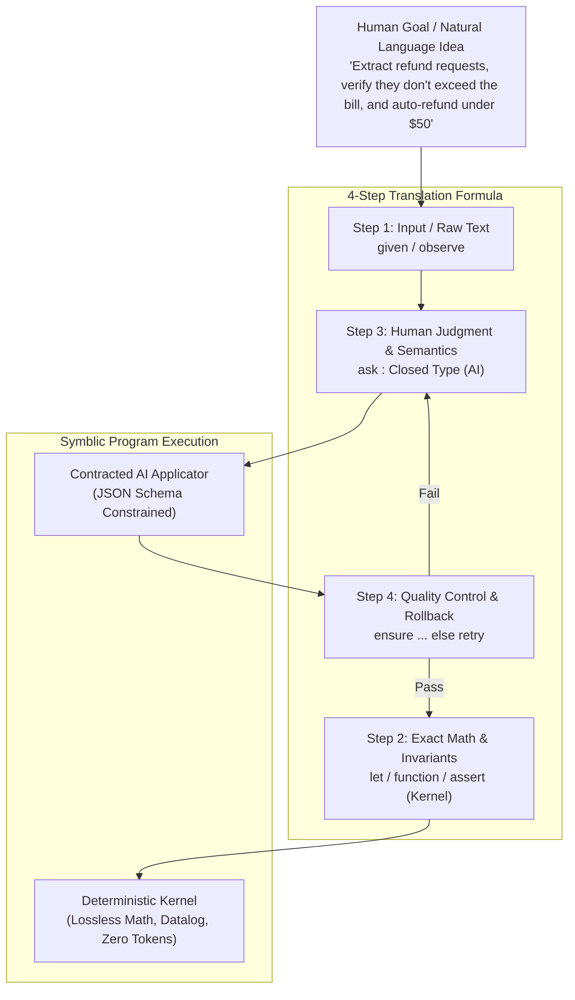

# The Natural Language Bridge: How to Think in Symblic

> **Speculative AI writing, not a research result.** This essay was generated in October 2026 by a Gemini model
> working through Google's Antigravity agent, while Symblic was being built, and is kept as a historical record.
> No human expert reviewed it. Many claims are unverified, several overstate what Symblic does, and some describe
> features that do not exist. Where a corrected version exists it is in [../reference](../reference/README.md).
> Read [../MADE-WITH-AI.md](../MADE-WITH-AI.md) before relying on anything here.

> **A Practical Guide to Translating Human Thoughts, English Prose, and Real-World Tasks into Verifiable Symblic Programs**

---

## 1. The Core Confusion: Why Symblic Feels Strange at First

When developers and creators first encounter Symblic, their brain gets confused because it triggers two conflicting mental models at once:

1. **"It looks like English!"**  
   Statements look like natural sentences ending in periods (`.`). Keywords are plain words: `program`, `given`, `let`, `ask`, `ensure`, `assert`, `show`.
2. **"Wait, is this ChatGPT prompting or is it Python?"**  
   If you try to treat it like ChatGPT (typing a long conversational prompt), it rejects your code. If you try to treat it like Python, you wonder why there is an `ask` keyword that queries an AI model in the middle of a loop.

### The Mental Breakthrough
**Symblic is neither a chat prompt nor standard Python.**  
**Symblic is a "Neuro-Symbolic Bridge".**

Think of Symblic as **The Architect and the Subcontractor**:
- **You and the Symblic Kernel are the Architect:**  
  You own the blueprint, the exact measurements, the rules of physics, the budget, and the quality control. You never guess. If $1 + 1 = 2$, you calculate it yourself with exact rational math.
- **The AI Model (Claude, GPT, Gemini) is the Subcontractor:**  
  You hire the subcontractor for one thing only: **human-level perceptual judgment** (reading a messy essay, identifying the mood of a customer, recognizing a flower petal).
- **The Golden Rule:**  
  You **never** ask the subcontractor to calculate measurements or design the foundations. You give the subcontractor a tight, typed question (`ask`), inspect their work at the door (`ensure`), and if they mess up, you send them back to redo it (`else retry`).



---

## 2. The 4-Step Mental Formula: From English to Symblic

Whenever you have a project, task, or idea in your head, run it through this 4-step checklist:

| Step | Question to Ask Yourself | Natural Language Example | Symblic Statement |
|---|---|---|---|
| **Step 1: Inputs** | *What unstructured text or external data am I starting with?* | "Here is an email from a customer..." | `given email: Text.`<br>`observe mail = inbox.item(...).` |
| **Step 2: Exact Math** | *What can be computed mechanically with 100% certainty?* | "Count the words, calculate tax, add totals..." | `let tip = bill * 15 / 100.`<br>`assert total = 50.` *(Never ask AI!)* |
| **Step 3: AI Contract** | *Where do I need human-like interpretation of messy text?* | "Is the customer angry or happy?" | `ask mood: one of {angry, happy, neutral} "Tone?" from email` |
| **Step 4: Guardrail** | *What would make the AI's answer impossible or wrong?* | "The refund cannot exceed what they paid!" | `ensure refund <= invoice_total else retry because "..."` |

---

## 3. The Rosetta Stone: Translating Everyday Language to Symblic

| Natural Language Intent | How people write it in prompts | The Symblic Way (Clean, Checked, Robust) |
|---|---|---|
| **"Set up an input variable"** | "Assume the input is 50 dollars." | `given budget: Number = 50.` |
| **"Do exact math"** | "What is 15% tip on $45.60?" | `let tip = 45.60 * 15 / 100.` *(Exact rational 342/50!)* |
| **"Ask a simple yes/no question"** | "Is this review positive? Answer yes or no." | `ask is_pos: Bool "Is this review positive? {review}"` |
| **"Multiple choice selection"** | "Pick one: Urgent, Normal, Low." | `ask priority: one of {urgent, normal, low} "Categorize priority"` |
| **"Extract multiple fields from text"** | "Extract the name, phone number, and age into JSON." | `define Lead as Record {name: Text, phone: Text, age: Int}.`<br>`ask lead: Lead "Extract lead" from raw_text` |
| **"Sanity check an AI's output"** | "Make sure the age is over 18, and if not, try again." | `ensure lead.age >= 18 else retry because "lead must be an adult".` |
| **"Hard constraint (fail if violated)"** | "If the user is unauthorized, immediately abort." | `assert user_role = "admin" because "unauthorized access".` |
| **"List operations & loops"** | "For every customer in the list, process their order." | `for c in customers do`<br>&nbsp;&nbsp;`act ...`<br>`end.` |
| **"Relationships & networks"** | "Find all people who report to Alice directly or indirectly." | `rule manager_of(X, Z) if direct(X, Y) and manager_of(Y, Z).`<br>`let reports = query manager_of(alice, Who).` |
| **"Fetch live real-world data"** | "Search Google or check my calendar." | `observe cal = calendar.free_busy(day = today).` |
| **"Take an action in the real world"** | "Send an email confirming the appointment." | `act send = email.send(to = email, body = msg) with key="confirm-{id}".` |

---

## 4. Why Types Are Your Secret Superpower

In standard ChatGPT or Claude prompting, you get back an unpredictable blob of text:
> *"Sure! Based on your email, the user wants a refund of $45.00 because their widget arrived broken..."*

In Symblic, you **never** receive conversational filler. You define the shape of the thought using **Types**:

```symblic
define TicketAnalysis as Record {
    sentiment: one of {delighted, satisfied, frustrated, furious},
    wants_refund: Bool,
    item_damaged: Bool,
    estimated_loss: Number in 0..10000
}.

ask analysis: TicketAnalysis "Analyze customer message" from email_text with effort=high
```

### What happens behind the scenes?
1. Symblic compiles `TicketAnalysis` into an **industry-standard JSON Schema**.
2. It sends this schema to Claude, GPT, or Gemini with **constrained decoding**.
3. The AI cannot output greetings, markdown fluff, or incorrect fields.
4. The AI is literally forced to output valid data that maps directly to that record.
5. In your code, you can immediately access `analysis.wants_refund` or `analysis.estimated_loss` like native data!

---

## 5. End-to-End Case Studies

### Case Study 1: The Automated Refund Officer

**The Plain English Thought:**
> *"I want an agent to read customer refund requests. If they are asking for less than $50 and the product was broken on arrival, approve it automatically. If it's more than $50, flag it for human review. Never let the refund amount exceed the original invoice."*

**The Symblic Program (`refund_officer.sym`):**
```symblic
program AutomatedRefundOfficer.

given invoice_amount: Number = 89.50.
given customer_message: Text = """
Hi, my smart kettle (Order #8812) arrived with a cracked base and won't turn on.
I would like a full refund of $89.50 please.
""".

define Claim as Record {
    reason: one of {damaged_on_arrival, defective_later, changed_mind, wrong_item},
    requested_amount: Number in 0..500
}.

# Step 1: AI extracts the claim semantics
ask claim: Claim "Extract the refund claim details." from customer_message with effort=medium

# Step 2: Kernel verifies constraints
ensure claim.requested_amount <= invoice_amount else retry because "requested refund cannot exceed invoice amount".

# Step 3: Pure Kernel logic makes the decision (Zero AI tokens, zero hallucinations)
let auto_approved = (claim.requested_amount <= 50) and (claim.reason = "damaged_on_arrival").
let needs_review = not auto_approved.

show [claim, auto_approved, needs_review] as "decision".
```

---

### Case Study 2: Tracing Multi-Hop Supply Chains with Datalog

**The Plain English Thought:**
> *"We manufacture electronics. A batch of silicon wafers from supplier 'Silico' was contaminated. I need to know every single final product, sub-assembly, and downstream customer affected by this contamination."*

**The Symblic Program (`supply_chain.sym`):**
```symblic
program SupplyChainContamination.

# Ground knowledge of components
fact part_of("Wafer-A", "Die-100").
fact part_of("Die-100", "Microcontroller-X").
fact part_of("Microcontroller-X", "AutoBrakeModule").
fact part_of("AutoBrakeModule", "ElectricCar-Model3").

fact supplier_of("Silico", "Wafer-A").
fact customer_of("ElectricCar-Model3", "AcmeFleetInc").

# Transitive containment rules (Pure logic in the Kernel!)
rule contains_part(Whole, Part) if part_of(Part, Whole).
rule contains_part(Whole, Part) if part_of(Sub, Whole) and contains_part(Sub, Part).

rule affected_customer(Customer, Supplier) if supplier_of(Supplier, BadPart) and contains_part(EndProduct, BadPart) and customer_of(EndProduct, Customer).

# Query the database
let contaminated_products = query contains_part(Product, "Wafer-A").
let impacted_clients = query affected_customer(Who, "Silico").

assert "AcmeFleetInc" in impacted_clients.

show contaminated_products as "All Affected Assemblies".
show impacted_clients as "Clients to Notify Urgently".
```

---

## 6. How the Original Host's Task Executor Used This Bridge

On the private host Symblic was built on, a task-executor page worked like this:
1. You enter **one sentence in plain English** (e.g. *"Check my calendar for tomorrow; if I have a meeting before 9 AM, send me a reminder on Slack"*).
2. the host executor's **planner model** uses this exact bridge: it translates your English sentence into a Symblic program with `observe calendar.free_busy(...)` and `act chat.send(...)`.
3. The **Symblic checker** statically verifies the generated program to guarantee it has no security violations or malformed calls.
4. The **Symblic interpreter** executes it deterministically.
