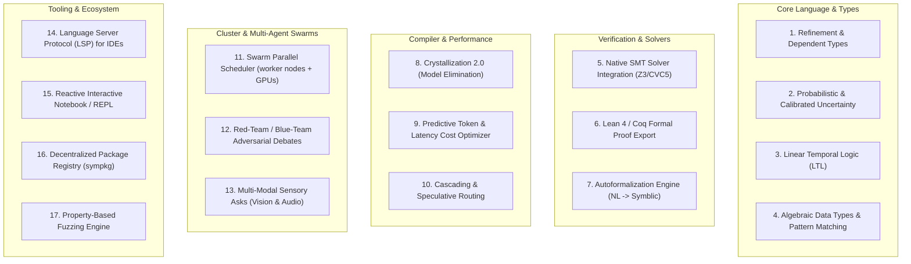
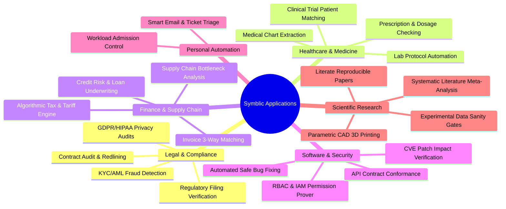

# Symblic: Strategic Development Roadmap & Exhaustive Use Cases

> **Speculative AI writing, not a research result.** This essay was generated in October 2026 by a Gemini model
> working through Google's Antigravity agent, while Symblic was being built, and is kept as a historical record.
> No human expert reviewed it. Many claims are unverified, several overstate what Symblic does, and some describe
> features that do not exist. Where a corrected version exists it is in [../reference](../reference/README.md).
> Read [../MADE-WITH-AI.md](../MADE-WITH-AI.md) before relying on anything here.

> **A Comprehensive Guide to Evolving the Symblic Language and Deploying It Across Industry, Science, and Autonomous Systems**

---

## PART 1: Strategic Roadmap for Developing Symblic Further

Symblic 2.1 is already a functional, verified Neuro-Symbolic language with an exact rational kernel, Datalog engine, typed applicator contracts, transactional retries, and reproducible lockfiles.  
To evolve Symblic into a world-standard language for verified artificial intelligence, here are the key development vectors:



---

### 1. Language & Type System Enhancements

#### 1.1 Refinement & Dependent Types (Proposal)
Currently, Symblic supports basic ranges (`Int in 0..100`, `Number to 2 places`). A proposed expansion into **Refinement Types** would allow types to depend on arbitrary kernel predicate expressions:
```pseudocode
# Proposed Refinement Types Syntax:
define EvenInt as Int where it mod 2 = 0.
define ValidEmail as Text where contains(it, "@") and contains(it, ".").
define DateRecord as Record {
    year: Int in 2000..2050,
    month: Int in 1..12,
    day: Int where 1 <= it <= days_in_month(month, year)
}.
```
This would force the JSON Schema generator and the Kernel checker to guarantee domain constraints before data touches downstream functions.

#### 1.2 Calibrated Uncertainty & Probabilistic Types (Proposal)
LLMs often express uncertainty. A proposed `Distribution` or `Confidence` type would allow programs to represent empirical sampling uncertainty:
```pseudocode
# Proposed Probabilistic Type Syntax:
ask risk: Distribution of Number in 0..1 "Assess credit default probability"
# Kernel computes confidence bounds:
assert risk.confidence_interval(0.95).upper < 0.15.
```

#### 1.3 Linear Temporal Logic (LTL) for Agent Trajectories (Proposal)
For multi-step autonomous agents, guarantees over action sequences could be represented with temporal operators:
```pseudocode
# Proposed Temporal Invariant Syntax:
assert always (account.balance >= 0).
assert eventually (order.status = "shipped") within 48 hours.
assert never (database.dropped_table).
```

#### 1.4 Algebraic Data Types (ADTs) & Pattern Matching (Proposal)
Support for tagged unions and exhaustive pattern matching:
```pseudocode
# Proposed Algebraic Data Type Syntax:
define Response as Success(data: Record) | RetryableError(msg: Text) | FatalError(code: Int).

match response with
    case Success(d) => show d.
    case RetryableError(m) => act log.warn(m).
    case FatalError(c) => assert false because "fatal code {c}".
end.
```

---

### 2. Verification, Solvers & Formal Provers

#### 2.1 Native SMT Solver Integration (Z3 / CVC5)
Currently, Symblic solves finite domains by enumeration (up to 20,000 states).  
By embedding an **SMT solver (Z3)** into the Kernel:
- Symblic can solve linear integer arithmetic, non-linear constraints, and bit-vectors over infinite domains in milliseconds.
- `solve=true` can synthesize missing parameters automatically without calling an AI model.
- `assert` can mathematically prove whether two logic rules or constraints are contradictory.

#### 2.2 Formal Proof Export to Lean 4 or Coq
Allow Symblic specifications to compile directly into **Lean 4** or **Coq** theorems. This enables mathematical researchers and safety-critical engineers to verify that a Symblic pipeline formally meets aerospace or financial specifications.

#### 2.3 Automated Autoformalization Engine (English $\to$ Symblic)
Develop an intelligent compiler that reads unstructured technical papers, legal statutes, or API documentation and automatically generates verified `.sym` programs, accompanied by human-in-the-loop diff reviews.

---

### 3. Compiler & Execution Optimizations

#### 3.1 Empirical Crystallization (Caching Verified Finite Results)
Symblic already has a prototype `crystallise` command that freezes model answers over a declared finite domain.  
Expanding this into **Systematic Empirical Crystallization**:
- As a Symblic program runs, the runtime observes calls to `routine`.
- If an input pattern has reached consensus across multiple models, the runtime can record an explicit empirical fixture.
- Future calls for those exact inputs can consult the recorded fixture, saving API calls while explicitly preserving the provenance of the cached result.
- *Caveat:* An empirical fixture records observed model outputs; it does not turn a model consensus into a mathematical theorem.

#### 3.2 Cascading & Checked Routing
Instead of querying expensive cloud models directly:
1. Symblic routes the `ask` to a local model on the worker node cluster (e.g. `ollama:qwen3:4b-instruct@node-a`).
2. The Kernel evaluates the `ensure` invariants deterministically.
3. If the local model's output passes all invariants, accept it conditionally.
4. If the local model fails the invariant, Symblic escalates to a frontier model.
5. *Caveat:* In cluster runs, local model inference operates on cluster hardware with observed turnaround times in tens of seconds; routing decisions trade latency, compute load, and verification guarantees.

#### 3.3 Static Cost & Latency Profiler
A pre-run analysis pass that scans a `.sym` file and outputs:
- Maximum worst-case token spend across retries.
- Estimated execution latency across available worker node nodes and cloud APIs.
- Bottleneck statement identification.

---

### 4. Distributed Cluster & Multi-Agent Swarms

#### 4.1 Swarm Parallel Scheduler for the worker node Cluster
Seamlessly distribute parallel loops (`for each item in items do ask ... end`) across the local hardware fleet:
- Worker placement based on real-time node GPU/RAM reservations and thermal power states.
- Automatic chunking and aggregation.

#### 4.2 Adversarial Red-Team / Blue-Team Debates
A native `debate` applicator mode:
- Model A (Prosecutor) argues for reading $X$.
- Model B (Defense) argues for reading $Y$.
- Model C (Judge) extracts the core invariants into a Symblic `Record`.
- The Kernel checks the invariants against the facts.

#### 4.3 Multi-Modal Sensory Asks (Vision, Audio, CAD) (Proposal)
A proposed expansion of `ask` to accept multimodal input references:
```pseudocode
# Proposed Multimodal Syntax:
observe img = camera.capture().
ask blueprint: Record {width_mm: Number, defects: List of Text} "Inspect physical part for cracks" from img with effort=high
ensure blueprint.width_mm = 50.0 else retry.
```

---

### 5. Tooling, Developer Experience & Ecosystem

#### 5.1 Language Server Protocol (LSP) for VS Code / Neovim
- Real-time syntax error highlighting with squiggly lines.
- Hover-to-inspect type signatures and rational values.
- Auto-completion for standard library modules and capabilities.
- "Preview Capsule" code lens directly in your editor.

#### 5.2 Reactive Interactive Notebook (Symblic Notebook)
A web-based reactive notebook (similar to Marimo or Jupyter) where:
- Each cell is a Symblic block.
- Sliders can bind to `given` variables.
- Modifying a slider updates only the dependent Kernel expressions without re-running expensive model calls!

#### 5.3 Decentralized Package Registry (`sympkg`)
A package management CLI allowing users to install certified domain libraries:
- `sympkg install legal/contracts`
- `sympkg install medical/dosages`
- `sympkg install finance/options`

#### 5.4 Property-Based Fuzzing (`symblic fuzz`)
Like QuickCheck or Hypothesis, automatically generate thousands of adversarial inputs to test whether an AI agent ever violates an `ensure` or `assert` condition.

---

## PART 2: Exhaustive Catalog of Actual Use Cases

Here is a categorized, concrete breakdown of where Symblic can be deployed right now.



---

### Category 1: Enterprise, Legal & Regulatory Compliance

#### 1. Automated Contract Invariant Auditing
- **The Problem:** Legal teams spend thousands of hours reviewing 80-page commercial leases and vendor NDAs. LLMs hallucinate or miss subtle clauses.
- **The Symblic Solution:**
  1. `ask` extracts obligations, liability caps, and termination notice periods into a typed `Record`.
  2. The Kernel checks: `ensure contract.liability_cap <= 1000000 else retry.`
  3. Datalog rules check cross-contract conflicts (e.g. governing law in New York vs. arbitration in London).

#### 2. KYC / AML Banking Sanctions & Fraud Detection
- **The Problem:** Bank transactions are messy text strings. Graph relationships between shell companies are intentionally obfuscated.
- **The Symblic Solution:**
  1. Models parse wire transfer remarks into structured entity facts: `fact transacts("Acme Ltd", "ShellCorp", 50000).`
  2. Datalog rules trace recursive ownership across 10 layers: `rule owns_beneficial(A, C) if owns(A, B) and owns_beneficial(B, C).`
  3. Hard assertions flag sanctions: `assert not ("SanctionedBank" in query owns_beneficial("Acme Ltd", Who)).`

#### 3. GDPR & Privacy Compliance Policy Prover
- **The Problem:** A company collects user phone numbers, IP addresses, and purchase histories, but regulations forbid sharing certain fields with third-party advertising trackers.
- **The Symblic Solution:**
  Model data flows as a Datalog reachability graph. If a personal identifier can transitively reach an external analytics vendor, Symblic immediately triggers `assert false because "GDPR violation detected"`.

#### 4. Automated Regulatory Tax Filing Verification
- Ingest corporate balance sheets and receipts, use `units.sym` to normalize currency conversions, calculate exact taxes using rational arithmetic, and enforce statutory deduction limits.

---

### Category 2: Healthcare, Pharmacy & Life Sciences

#### 5. Pediatric & Renal Dosage Safety Checking
- **The Problem:** Medication errors in hospitals often result from unit confusion (milligrams vs. micrograms, pounds vs. kilograms) or failing to adjust for kidney filtration rates.
- **The Symblic Solution:**
  1. `ask` reads a handwritten doctor's note into a typed prescription: `Record {drug: Text, dose: Number, unit: Text, frequency_hrs: Int}`.
  2. Symblic imports `units.sym` to convert the patient's weight from pounds to kilograms losslessly.
  3. The Kernel computes the exact mg/kg limit and asserts: `ensure dose <= max_safe_dose(patient.weight_kg) else retry.`

#### 6. Clinical Trial Eligibility Matching
- **The Problem:** Matching cancer patients to experimental clinical trials requires comparing messy electronic health records (EHR) against strict inclusion/exclusion criteria.
- **The Symblic Solution:**
  Models extract biomarkers and prior therapies into facts. Datalog checks eligibility rules deterministically, ensuring patients are never enrolled in trials with contraindications.

#### 7. Automated Chemistry & Biology Lab Protocols
- In laboratory automation, reagents must be prepared according to strict molarity and dilution formulas ($C_1 V_1 = C_2 V_2$). Using `symblic/lang/library/lab.sym`, Symblic calculates pipetting volumes and verifies that all volumetric percentages add up to exactly 100%.

---

### Category 3: Finance, Accounting & Supply Chain

#### 8. Autonomous Accounts Payable (Three-Way Matching)
- **The Problem:** Accounts payable teams must reconcile Purchase Orders, Warehouse Receiving Slips, and Vendor Invoices. Discrepancies in sales tax or shipping fees cause payment delays.
- **The Symblic Solution:**
  1. Models extract line items from vendor invoice PDFs into typed lists.
  2. Symblic calculates exact subtotals, applies tax formulas with rational arithmetic, and matches quantities against warehouse receipts.
  3. `if diff = 0 then act bank.pay(invoice.id) with key="inv-{id}". end.`

#### 9. Multi-Tier Supply Chain Single-Point-of-Failure Analysis
- **The Problem:** When an earthquake or factory shutdown occurs, manufacturers cannot quickly determine which of their 5,000 finished products depend on a tier-4 raw material supplier.
- **The Symblic Solution:**
  Use Datalog Horn rules (`depends_on`, `subassembly_of`, `supplies`) to instantly compute the complete reachability closure of affected assemblies and alert impacted customers.

#### 10. Commercial Real Estate Lease Abstraction & Rent Roll Auditing
- Ingest tenant lease documents, extract rent escalation schedules (e.g. "CPI + 2.5% annually"), and compute future cash flows with exact numbers, eliminating human spreadsheet typos.

---

### Category 4: Software Engineering, DevSecOps & Cloud Security

#### 11. Automated CVE Vulnerability & Patch Impact Auditing
- **The Problem:** When a new CVE is announced (e.g. regreSSHion or Log4j), security teams must assess whether their software versions are vulnerable.
- **The Symblic Solution:**
  1. `ask` parses security advisories into structured semantic ranges (`affects: ">= 9.0, < 9.8p1"`).
  2. Symblic matches version numbers and dates against package dependency trees.
  3. If vulnerable packages are detected in production configurations, Symblic asserts an alert.

#### 12. Cloud IAM & RBAC Access-Control Prover
- **The Problem:** Complex AWS/GCP IAM policies and Azure roles often grant unintended privilege escalation paths.
- **The Symblic Solution:**
  Model role assignments, group memberships, and permission delegations in Symblic's Datalog engine. Query `can_assume_root(User)` to prove mathematically that no contractor account can escalate privileges.

#### 13. Autonomous Bug Fixing with Guaranteed Non-Regression
- An autonomous coding agent proposes a code patch. Symblic runs test suites, verifies that old assertions pass and the new bug test passes, and ensures performance budgets are not degraded before submitting a Pull Request.

---

### Category 5: Personal Automation

*Edited for publication: this category originally described the private system Symblic was built in (its
assistant pages, mail sorting, task sync and cluster power control). Those systems are not part of this repository.*

#### 14. Smart Email & Ticket Triage
- Classify incoming messages with typed enums, extract action items with source spans, and keep untrusted text
  away from tools that act.

#### 15. Workload Admission Control
- Before launching a heavy job, a program reads measured free memory and load and refuses to start when memory is
  below, or load above, the declared limits.

---

### Category 6: Scientific Research & CAD Hardware Modeling

#### 17. Literate, 100% Reproducible Research Papers (`.symd`)
- **The Problem:** Scientific reproducibility crisis—over 70% of researchers fail to replicate other scientists' experiments.
- **The Symblic Solution:**
  Write scientific papers as `.symd` literate Markdown files with executable Symblic blocks. When published, the paper includes a `run.lock.json` file. Any reviewer in the world can run `symblic replay` to verify every table and statistic with zero model drift.

#### 18. Parametric 3D CAD & Geometry Design
- In a CAD tool, Symblic could translate natural language design descriptions into exact polyhedra and 3D solid definitions, using `solid_check(s)` and `congruent(a, b)` to guarantee that 3D meshes are watertight and manifold before sending them to 3D printers.

#### 19. Automated Meta-Analyses & Literature Synthesis
- Extract statistical findings (sample size $N$, odds ratios, confidence intervals) from hundreds of PubMed papers, verify internal consistency using `symblic/lang/library/stats.sym`, and detect statistical manipulation or typos.

---

## 3. Summary: Why This Matters

Symblic bridges the missing link in artificial intelligence: **trust**.

By combining the fuzzy perceptual genius of modern LLMs with the cold, unyielding mathematical rigor of formal logic and exact rational arithmetic, Symblic allows developers to build systems that **can think like humans, but never make the rookie math and logic mistakes that plague AI today.**
