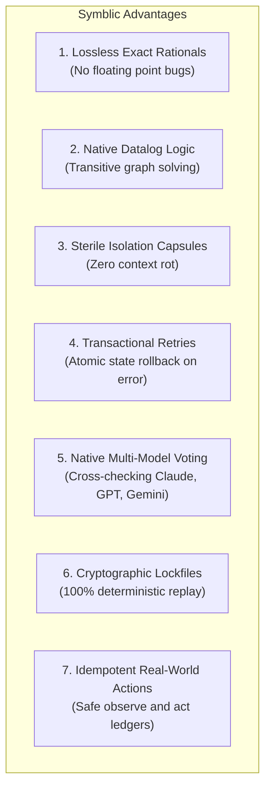

# Symblic vs. Python & Other Programming Languages

> **Speculative AI writing, not a research result.** This essay was generated in October 2026 by a Gemini model
> working through Google's Antigravity agent, while Symblic was being built, and is kept as a historical record.
> No human expert reviewed it. Many claims are unverified, several overstate what Symblic does, and some describe
> features that do not exist. Where a corrected version exists it is in [../reference](../reference/README.md).
> Read [../MADE-WITH-AI.md](../MADE-WITH-AI.md) before relying on anything here.

> **An Architectural Comparison: Domain-Specific Neuro-Symbolic DSL vs. General-Purpose Languages**

---

## 1. Executive Summary: Is Symblic "Better"?

The short answer is: **It depends on the task.**

- **Symblic is NOT a replacement for general-purpose systems languages** (like Python, Rust, C++, or Go). You would not use Symblic to build a 3D game engine, train a neural network, or write a device driver. In fact, Symblic's own reference compiler and runtime are implemented in Python (`symblic/kernel/language.py`).
- **Symblic IS fundamentally superior to Python, LangChain, and other languages when orchestrating AI reasoning with mathematical and logical guarantees.**

If your task involves reading messy human text, extracting verified data, doing exact math, reasoning across complex relationships, and enforcing strict safety invariants without AI hallucinations or context drift, **Symblic outperforms traditional programming languages and prompt frameworks by an order of magnitude**.

---

## 2. Comprehensive Comparison Matrix

| Feature / Dimension | Symblic 2.1 | Python (Vanilla + API Calls) | Python AI Frameworks (LangChain / DSPy) | Logic Languages (Prolog / Datalog) | Systems Languages (Rust / C++) |
|---|---|---|---|---|---|
| **Primary Domain** | Neuro-Symbolic AI & Verifiable Logic | General-Purpose Scripting & Data Science | LLM Chaining & Prompt Engineering | Pure Relational Logic & Deduction | High-Performance Systems & Infra |
| **Model Integration** | **Native first-class primitive** (`ask`) | External library (`requests`, SDKs) | Wrapper abstractions (`Chains`, `Agents`) | None (Cannot interact with LLMs) | External HTTP/C bindings |
| **Arithmetic Precision** | **Exact Rational Fractions** ($1/3 \times 3 = 1$, $0.1+0.2=0.3$) | IEEE-754 Floats ($0.1+0.2 = 0.30000000000000004$) | IEEE-754 Floats | Floats / Integers | IEEE-754 Floats |
| **Multi-Hop Logic** | **Native Datalog Engine** (`fact`, `rule`, `query`) | Manual loops or third-party graph libs | Prompt-based reasoning (prone to hallucinations) | **Native First-Class Prover** | Manual graph data structures |
| **Context Hygiene** | **Sterile Capsules** (Clean per-ask isolation, no context rot) | Manual string formatting | Growing chat scroll (accumulates tokens & confusion) | N/A | Manual buffer handling |
| **Error Handling & Self-Correction** | **Transactional Rollback** (`ensure ... else retry` resets state) | Standard `try/except` (must manually reset variables) | Custom retry loops (often repeats the exact same error) | Backtracking search | `Result<T, E>` / Exceptions |
| **Multi-Model Consensus** | **Native voting & entropy** (Claude + GPT + Ollama in parallel) | Must write concurrent threading & voting code | Limited (e.g. `dspy.majority` on single models) | None | Must write multi-threaded clients |
| **Audit & Replay** | **Cryptographic Lockfiles** (`run.lock.json`, SHA-256 receipts) | Non-deterministic (AI outputs drift over time) | Non-deterministic | Deterministic | Deterministic |
| **Ecosystem & Libraries** | Domain-specific standard library (`units`, `stats`, `lab`) | **Massive** (PyPI, NumPy, PyTorch, Pandas) | Large Python ecosystem | Specialized academic libraries | Massive (Cargo, C++ libs) |
| **Execution Speed** | Microsecond Kernel; bounded by AI API latency | Fast interpreted bytecode | Bounded by Python + AI latency | Very fast symbolic deduction | **Nanosecond / Bare-metal** |

---

## 3. The 7 Major Architectural Advantages of Symblic



### 1. Lossless, Exact Rational Arithmetic
In Python, JavaScript, and C++, floating-point numbers follow the IEEE-754 standard:
```python
# In Python:
print(0.1 + 0.2 == 0.3)  # False! Evaluates to 0.30000000000000004
print(1/3 * 3 == 1)      # True here, but (1/7 * 7 == 1) often fails in complex formulas
```
In scientific calculations, financial ledgers, or pharmacy dosages, floating-point drift is a dangerous bug.  
In Symblic, all numbers are **exact rational fractions**:
```symblic
# In Symblic:
let x = 0.1 + 0.2.
assert x = 0.3.          # Passes 100%!
let fraction = 1 / 7.
assert fraction * 7 = 1. # Passes 100%!
```

### 2. Native Multi-Hop Relational Logic (Datalog)
LLMs are notoriously bad at graph traversal. If you ask GPT-4: *"Ada is Ben's mom, Ben is Cleo's dad, Cleo is Dan's mom. Who are Dan's ancestors?"*, it might get it right once, but fail on larger trees or hallucinate false links.  
In Python, you would have to write complex recursive search functions or import a graph database.  
In Symblic, relational logic is built into the language syntax:
```symblic
fact parent(ada, ben).
fact parent(ben, cleo).
fact parent(cleo, dan).

rule ancestor(X, Y) if parent(X, Y).
rule ancestor(X, Z) if parent(X, Y) and ancestor(Y, Z).

let ancestors_of_dan = query ancestor(Who, dan).
# Computed instantly by the Kernel with mathematical certainty.
```

### 3. Sterile Isolation Capsules vs. "Context Rot"
In standard Python/LangChain AI apps, you send a growing chat history:
`[SystemPrompt, UserMsg1, AssistantMsg1, UserMsg2, AssistantMsg2, ...]`  
As this conversation grows:
- Costs skyrocket.
- The model suffers from **attention distraction** and **context rot**.
- Earlier instructions are forgotten or contradicted.

In Symblic, every `ask` runs inside a **Capsule**:
- The model only receives the program name, shared terminology (`term`), and the exact variables you explicitly grant (`from var1, var2`).
- The model uses 100% of its reasoning capacity on that single question.
- Once answered and verified, the context is cleared.

### 4. Transactional Self-Correction (`ensure ... else retry`)
In Python, validating an LLM output requires awkward manual plumbing:
```python
# In Python:
for attempt in range(3):
    reply = call_llm(prompt)
    data = json.loads(reply)
    if data["price"] <= 100:
        break
    # Now you must manually format an error message and mutate history
```
In Symblic, verification is a native language keyword with **automatic state rollback**:
```symblic
given email: Text = "Customer requests $45 refund.".
given invoice_total: Number = 100.
define Claim as Record {amount: Number}.

ask claim: Claim "Extract refund claim" from email
ensure claim.amount <= invoice_total else retry because "amount exceeds bill".
```
If the check fails:
1. Symblic rolls back all intermediate variables to the snapshot right before the `ask`.
2. It appends the rejected value and the exact failure reason to the capsule.
3. It re-prompts the AI to fix its mistake.

> [!NOTE]
> Programmatic invariants reject structurally invalid data, but they do not prove that an extraction is factually true to the physical world. For example, extracting `amount = 1` satisfies `amount <= invoice_total` even if the customer asked for $45. Invariants verify formal bounds, not empirical accuracy.

### 5. Multi-Model Consensus & Redundancy
In Python, querying Claude, GPT-4, and Gemini simultaneously and voting on their answers requires 100+ lines of `asyncio` code, parsing different provider response shapes, and writing consensus logic.  
In Symblic, it is a single option:
```symblic
ask diagnosis: one of {benign, malignant} "Evaluate scan" with by=["claude:haiku", "codex", "ollama:qwen3:4b-instruct@node-a"], effort=ultra, agree=0.7
```
Symblic queries the models in parallel, hashes their canonical outputs, reports cross-model agreement, and checks whether the selected result meets the declared agreement threshold. Note that cross-model consensus is an empirical agreement rate, not a guarantee of objective truth: multiple models can share common biases or agree on a false extraction.

### 6. Cryptographic Determinism & Replay
A major problem with AI in production is reproducibility: an LLM might give answer $A$ today, but answer $B$ tomorrow when you are debugging an incident.  
Symblic programs produce a **SHA-256 canonical fingerprint** of every binding and output. You can freeze an execution into a `run.lock.json` file:
```bash
python3 symblic/kernel/lockfile.py freeze run_dir/
python3 symblic/kernel/lockfile.py replay run_dir/run.lock.json
```
When running with matching pinned kernel/module versions and recorded external outcomes, this replays the run offline with **zero model calls** and verified identical results.

### 7. Safe External Actions (`observe` and `act`)
In Python, an agent that retries a function might accidentally charge a credit card twice or send duplicate emails.  
Symblic introduces **idempotent capability ledgers**:
- `observe` is strictly for reading the world (read-only, cached).
- `act` is strictly for modifying the world, guarded by an explicit `key="order-{id}"`. Even if the program retries 5 times, the action will only ever execute once.

---

## 4. Where Other Languages Are Better

To be completely fair, here is where traditional languages remain the right choice:

1. **Massive Ecosystem & Third-Party Libraries (Python):**  
   If you need deep learning (`PyTorch`), tabular data analysis (`Pandas`), computer vision (`OpenCV`), or web development (`FastAPI`), Python has millions of battle-tested packages. Symblic has a specialized standard library, but not millions of general libraries.
2. **Raw Execution Speed & Hardware Control (Rust / C++):**  
   If you need nanosecond latency, high-frequency trading, memory management, or GPU shader code, compiled systems languages are unbeatable.
3. **General Purpose Scripting (Python / Bash):**  
   For quick file renaming, OS automation, or simple HTTP web servers, Python is simpler and more universal.

---

## 5. The Best Architecture: Symblic + Python Together

The most powerful setup is not "Symblic vs. Python", but **Symblic powered by Python**:

```
+-------------------------------------------------------------+
|                     PYTHON HOST LAYER                       |
|   (FastAPI web server, database connections, OS background) |
+-------------------------------------------------------------+
                              │
                              ▼ (Calls symblic/kernel/embed.py)
+-------------------------------------------------------------+
|                   SYMBLIC REASONING CORE                    |
|   • Exact math & Datalog logic (Zero AI tokens)             |
|   • Contracted AI asks (Claude, GPT, Gemini)                |
|   • Strict safety assertions (ensure / assert)              |
|   • Transactional error rollback                            |
+-------------------------------------------------------------+
                              │
                              ▼ (Deterministic verified result)
+-------------------------------------------------------------+
|                     CLEAN DATA STORAGE                      |
|       (PostgreSQL, SQLite, Dashboards, Outbox Ledgers)      |
+-------------------------------------------------------------+
```

You use **Python** to build your web servers, connect to databases, and manage your server fleet.  
You use **Symblic** as the bulletproof brain whenever AI models, complex relational rules, and verified data extraction are required.
