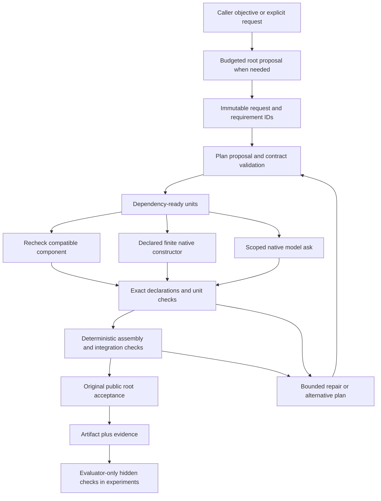

# MICA: bounded contract assembly through native Symblic

MICA (Minimum-Intelligence Contract Assembly) turns a public objective or an explicit request into checked JavaScript functions. A local model can propose requirements and a dependency graph; the host validates that graph, chooses eligible local workers, checks each unit, assembles the program, and evaluates its original public acceptance examples. Failed branches can trigger bounded repair or another decomposition. Every model call passes through the existing Symblic interpreter and admitted fleet-runner provider lane.

This implementation constructs pure JavaScript functions as **one assembled script or an explicit ES-module bundle**. Module bundles contain a public entry and independently checked unit modules with a closed static import graph. They do not yet support arbitrary repositories, package installation or deployment. Contract `permitted_effects` is empty; generated paths label artifacts and grant no file access. The host writes bounded artifacts and evidence to its private run store.

Scoped host costs, kernel fixes, versioned proposal encoding and accepted Forge construction were installed on 2026-10-10 in a second guarded rollout. Its dashboard restart changed the process id; HTTP, the operator API and both CLI command surfaces were checked. Eleven browser journeys passed against the installed files in 25.306 seconds. The initial CLI, API and Construct panel were installed on 2026-10-10. The dashboard restart changed the process id and the page, assets and API returned HTTP 200. Ten browser journeys passed again against the installed files; direct phone/desktop inspection confirmed the layout and theme. Actual successful local-model demonstrations and empirical six-mode comparisons remain pending until their own receipts are recorded. No performance gain, optimal decomposition, universal weak-model capability, or general correctness theorem has been established.

The third guarded rollout adds the graph/worker frontier, early unit/root example consistency checks, finite verification-pack CLI and sealed result status in API lists. Its combined 154 checks passed on node-i in 91.642 seconds. The installed `tools/symblic mica` capabilities and pack freeze/public/fixture/validate journey passed, historical exhausted jobs remained readable, and the dashboard returned HTTP 200 after the restart. The older frozen development pilot continued in its separate scope; both dashboard restarts are retained as host-environment observations. These are implementation and operational receipts, not evidence of a search performance gain.

## Authority and evidence

There are three different specifications:

1. The original caller objective and output/budget authority are immutable.
2. An objective-only run asks a local model to propose explicit requirements, assumptions, function signatures and public checks. A host-derived clause frontier requires every exact source span and proposed requirement to be mapped; explicitly declared public signatures must survive unchanged, and known template placeholders are refused. These mappings remain **model-proposed interpretations**, not an independent oracle for the caller's intent. Consequential unresolved choices are returned as `missing_decisions`.
3. Benchmark hidden tests belong to the evaluator. They never enter root synthesis, planner prompts, worker capsules, repair feedback, or the runner callback.

`planned` means a contract graph validated; no implementation has been accepted. `done` with assurance `TESTED` means the retained finite interface, unit, integration and public root checks passed. It does not mean arbitrary prose is proven. A `PROVEN` requirement blocks completion when no supported proof links it to the emitted JavaScript. Finite predicate implication receipts describe only their encoded predicates and finite domains.

Hashes connect exact requests, source, dependencies and receipts. They are local integrity/compatibility checks, not authenticated provenance against a malicious host. Native source identity checks detect stale loaded modules and changed source before execution or recovery.

## Proposal encoding

Objective proposals use an explicit `proposal_version: 3` envelope. Each public test supplies an ordinary JSON `expected_value`; the host lowers its exact JSON token to the existing contract `expected` JSON-text field. It preserves number spelling, negative zero, strings and nested values, rejects duplicate keys and nonfinite/overflowing numbers, and records the raw proposal and per-test transformation digests. It never repairs an incorrect expected answer or reinterprets a string as code or JSON. Historical legacy proposals with `expected` remain decodable with transformation `none`; new declared root asks require the version-3 shape. Readers reconstruct the normalization from retained native output rather than trusting a claimed transformation receipt.

Root, graph and scoped-refinement asks use the native `Code json schema "<literal>"` opt-in. They request one raw JSON document; the kernel preserves its exact reply text and independently checks the declared shape before existing authority checks. This adds provider grammar constraints through the current local Ollama format interface. It does not establish semantic correctness or an improvement in model success. Ordinary unstructured Code asks retain their behavior; the old matched pilot retains its frozen implementation.

The full expanded schema, displayed field meanings and prompt all count against the original context allowance and enter the existing call key before dispatch. Repeated prompt descriptions may be factored; the provider argument is not shortened. The closed shape subset and finite byte/depth/node/validation bounds are documented in [Declared JSON output shape](STRUCTURED-JSON.md). Unsupported grammar is a visible provider failure; no retry drops the schema. Explicit failed-launch refusals in the authoritative journal are blocked and ungraded; all retained intents and any earlier dispatched calls remain counted. Provider decoding support outside the inspected local Ollama path is unverified. Resource-limited shape checks are ungraded verification unknown, and a full unit budget stops scoped refinement before planner selection or reservation.

The parser/helper and complete optional JavaScript-normalizer closure enter kernel/execution identity. This changes compatibility pins: old execution/resume receipts require their original coherent runtime; historical read-only artifacts retain their frozen identity. The normalizer's code transformation behavior is unchanged.

## Execution path



The code path is `MicaProject` → `MicaRun` → `symblic.mica.native` → native `Run` with the existing graph call journal, provider adapter, and JavaScript checker. Explicit request runs begin at `MicaRun`. Models emit proposal JSON or source text; they cannot choose a host executor or call a web-supplied endpoint.

| Module | Responsibility |
|---|---|
| `symblic/mica/project.py` | Budgeted objective-to-request synthesis, original authority, assumptions/provenance, missing decisions and project recovery |
| `symblic/mica/proposal.py` | Strict versioned proposal decoding and exact JSON-value lowering with retained transformation evidence |
| `symblic/mica/contracts.py` | Bounded JSON request/contract IR, requirement coverage, dependency DAG, scopes, hashes and finite refinement checks |
| `symblic/mica/search.py` | Alternatives, eligible routing, ready-layer scheduling, component decisions, assembly, root checks and cumulative evidence |
| `symblic/mica/native.py` | Native source lowering, frozen attempt identity, typed asks, call reservation/outcomes and observed provider receipts |
| `symblic/kernel/json_schema.py` | Bounded closed JSON shape validation preserving the original reply string |
| `symblic/mica/deterministic.py` | Explicit bounded integer-affine family compiled into native finite determination |
| `symblic/mica/refinement.py` | Scoped replacement of one failed contract by fresh helpers, retaining its wrapper, original checks and outside graph |
| `symblic/mica/routing.py` | Exact-identity empirical summaries, uncertainty, eligibility and comparable cost ranking |
| `symblic/mica/strategy.py` | Bounded graph/worker alternatives, explicit partial cost scores and immutable recovery decisions |
| `symblic/mica/checkpack.py`, `symblic/mica/checkpack_cli.py` | Frozen requirement-linked finite check data and CLI export; no new executor |
| `symblic/mica/library.py` | Bounded private component variants keyed by contract, complete dependencies and runtime; recheck before reuse |
| `symblic/mica/costs.py` | Durable scoped wall/thread-CPU spans; interrupted costs remain unknown; partial instrumentation is not total compute |
| `symblic/mica/forge.py`, `symblic/mica/forge_cli.py` | Exact accepted Forge handoff bindings into the existing fixed-plan construction runner |
| `symblic/mica/calibration.py` | Explicit terminal-run audit and frozen cross-run routing evidence, retaining failures and ungraded calls |
| `symblic/mica/bundle.py`, `symblic_mica_bundle_runner.js` | Deterministic module compilation, closed sandbox module loading, original and external checks, verified ZIP export |
| `symblic/mica/bench.py` | Frozen six-mode assignments, hidden grading, unknown-outcome isolation and complete denominators |
| `symblic/mica/fixtures.py` | Independent seeded development fixtures for arithmetic/collections and strict JSON parsing |
| `symblic/mica/cli.py`, `integration/host/symblic_mica_api.py` | JSON agent interface and operator-gated durable browser jobs |

Contract fields include parent and root requirement IDs; explicit pre/postconditions and invariants; input/output artifacts; dependency contracts; permitted read/write/effect scopes; verification obligations; resource budgets; model eligibility; failure policy; version and content hash. Validation rejects missing coverage, dependency/parent cycles, conflicting output authority, path traversal, undeclared dependencies, unsupported effects, and enlarged child budgets. A syntactically valid graph is not a successful construction.

Workers receive their own scoped authoritative requirements and the exact declared dependency closure. Top-level function declarations must match the declared interface, even if sparse examples would pass without the function. Complete dependency artifact identity includes its contract: identical source with changed requirements is not automatically the same dependency.

Scheduling runs ready DAG layers in bounded batches, with at most three actual worker threads and a per-physical-node model lock. Fleet admission remains authoritative across unrelated processes. In `search` and `mica`, a bounded AND/OR frontier retains alternative graphs and eligible worker assignments: all contracts in one selected graph must pass. A later failure can return to an older graph for refinement or choose another worker assignment. Structural refinement preserves the original wrapper, checks, authority, dependency interfaces and unaffected contracts while adding reachable helpers. Compatible accepted units are rechecked and reused. An escalation policy can select another eligible local model without replanning; a stop policy prevents further dispatch.

The frontier considers at most 32 alternatives within the original candidate allowance and eight eligible routes per unit. It scores a bounded Cartesian neighbourhood; it is neither exhaustive nor globally optimal. Comparable observed cost components use one declared unit; missing components remain visibly unknown, and partial subtotals are not whole-program forecasts. Every decision freezes its exact evidence prefix, inventory, graph lineage, route assignment and root budget. Recovery verifies that decision instead of reranking it from newer observations. A candidate slot includes proposal/admission/build work, so a one-candidate allowance can still produce a complete artifact.

Before any unit generation, plan admission also rejects a proposed unit example that contradicts an original root example for the same direct call. This conservative check requires the exact owned export signature, JSON-literal arguments and no setup or dependency context. It preserves numeric argument spelling and object order. Unsupported expressions remain unassessed; the gate never changes original expected answers or claims general semantic equivalence.

## Budgets, stopping and recovery

New MICA requests that omit `context_chars` default to 32,768 characters, including the full schema cost. Explicit budgets and every already normalized/frozen 24,000- or 40,000-character request keep their original value; this does not change native language defaults or raise an existing run allowance.

The full normalized request budget covers `max_calls`, `max_candidates`, `max_depth`, `max_units`, `max_workers`, `retries`, `context_chars` and `wall_seconds`. Objective synthesis and planning consume the original call/time allowances. Resume retains the original start time, request, mode, inventory, implementation identity and component-library choice. Child/unit allowances cannot expand the root budget. Provider options bound output to 4,096 tokens and context to 16,384 tokens. Root synthesis/planning may use up to 900 seconds per call; implementation calls use up to 300 seconds, each additionally bounded by its original root/unit deadline. The native planner receives the declared character allowance, including complete capsule overhead. Trusted verification deadline scopes also cover native candidate threads and sequential interface/checker calls. These are backend controls, not measured aggregate GPU/energy costs.

Native call intent is durable before dispatch. Unknown deliveries block new work and are never silently retried. Recovery audits all retained native journals before dispatch or accepting cached success, including later parallel units. Completed attempts replay retained outcomes; source, route, input or journal changes fail closed. Reservations are separately reported from actual retained dispatch intents.

Browser jobs reuse the existing graph job generation, worker lifetime and stop locks. A delayed worker cannot run after its generation was canceled. Stop waits for the old generation to give up its lifetime; only an explicit Resume reserves a new one. A stopped job retains its spent/reserved budget and original deadline. Reconnecting or reading status never launches work. Unknown outcomes remain terminal in the browser interface pending separate investigation.

Artifact reads verify retained source bytes against their digest. They do not open filenames supplied by generated code. Optional component reuse is private, bounded to eight variants per exact identity, and reruns current interface/unit/root checks. Benchmarks disable a shared component library to avoid silent cross-arm contamination.

Module requests use `artifact_format: "javascript_modules"`. The first `allowed_outputs` path is the generated public entry; every additional declared path must belong to exactly one unit. The planner may select these paths using `output_path`; omitted unit paths default to `units/<id>.js`. The compiler alone adds exact static imports and exports. All original script checks must pass, followed by actual strict ES-module unit and entry checks in fresh isolated contexts. Dynamic imports, built-in modules, host loaders and undeclared dependencies are refused. This supports pure function module graphs, not general package semantics. A script request has exactly one output. Module artifact reads reconstruct every file and import without executing candidate code; ZIP export preserves relative directories.

## Frozen finite verification packs

`tools/symblic mica checkpack capabilities` describes the declaration schema. The `binding` command produces exact requirement text/span witnesses. A declaration supplies finite function cases or an explicitly asserted unary `decode(encode(x)) = x` law, a seed, visibility, origin and evaluation split. `freeze request.json --declaration declaration.json` emits a private sealed pack; retain its SHA independently. `public`, `fixture` and `validate` each require `--freeze ORIGINAL_PACK_SHA`.

Only the `public` output enters construction. It preserves the original tests as an exact prefix. The evaluator-only `fixture` output contains hidden checks for the existing benchmark. Model-proposed rows remain excluded from acceptance; a caller-supplied source link does not prove that a law follows from the requirement. The seed controls case order, not sampling, and bounds refuse overflow instead of dropping cases. JSON literal inputs are lowered as data, including computed object keys, within a documented finite safe-number fragment. No arbitrary input expressions or model-generated oracle is executed by the generator.

For a benchmark that verifies the generator linkage, export `tools/symblic mica checkpack linked-fixture pack.json --freeze ORIGINAL_PACK_SHA`. This optional fixture envelope retains the sealed pack, exact exported fixture digest, and generator/checker source identities. Benchmark freeze validates and regenerates the fixture, seals its private sidecar in the benchmark manifest, and revalidates current identities before dispatch, before hidden grading and before publication. Drift leaves the outcome unknown and does not trigger another dispatch. Only the separate `public` export belongs in construction context; the linked fixture contains evaluator-only checks. Historical reports validate the retained derivation without requiring current source identities. Ordinary unlinked fixtures retain their existing format.

Literal-number admission uses the exact stored value independently of the ambient Python Decimal context. General automatic property discovery, differential consensus as truth, and semantic completeness are not claimed.

## Models and measurements

Only the registered local Ollama lane is eligible. Inventory rows identify the exact model and physical node, with explicit readiness and availability. Page loads and reconnects read cached the fleet runner facts. **Refresh workers** explicitly refreshes cluster readiness and probes the catalogue on online physical worker node nodes, with at most two probes at once, before rereading inventory. It preserves the user's edited controls and exposes partial probe failures. The inventory is a snapshot, not a reservation; actual launch admission checks remain required.

A missing catalogue model digest is an explicit cold start. It can be dispatched through admitted infrastructure, but it cannot borrow evidence from another digest/model/node or receive an empirical success advantage. A caller-pinned digest must have matching observed native provider evidence. Failed deliveries with unavailable identity preserve their provider timeout or stop; missing evidence is not an affirmative identity conflict. Malformed evidence, an affirmative route mismatch and observed digest drift remain refusals. Affirmative observed weight drift is rejected even when the starting digest was unknown. These are provider manifest observations, not an independent attestation of loaded weights. Unknown context capacity also remains explicitly unknown.

Routing groups genuine noncached observations by model, node, observed digest and declared task class. It retains failures and unknowns, uses a Wilson lower bound to reduce small-sample overconfidence, and compares costs only in a common dimension. Inventory estimates remain estimates. Missing verification/scheduler overhead is not invented. Current observations mostly describe local encoded unit/planning acceptance; they do not establish whole-program capability or a fitted capability-versus-granularity law.

Optional calibration freezes an explicit selection of terminal run folders under shared project/construction/native locks. It validates source/checker pins, original requests, branch decisions, complete event and native call journals, exact retained program bytes, provider measurements, accepted component receipts and call totals. Unknown deliveries, busy or redirected paths, conflicting identities and capacity overflow refuse the whole import. Both successful and failed fresh observations survive; cached/zero-dispatch rows and ungraded root calls are explicitly accounted for. Importing a snapshot never scans history or starts a model. It is frozen into the next run, contributes routing evidence only, and is never re-exported as new evidence or charged as current calls. Historical digests cannot attest a cold current inventory. Caller selection can bias the sample; confidence bounds remain descriptive routing heuristics, not calibrated population accuracy or training.

Costs distinguish actual journal dispatch count, call reservations, observed input/output tokens, provider milliseconds, end-to-end milliseconds/seconds and missing CPU/memory/USD measurements. Partial measurement coverage is reported. Absence of a paid API charge does not establish zero energy or hardware cost.

## Scoped host costs

The instrumented runtime records scheduler, assembly and verification spans in the existing construction journal and a sealed native cost journal. Each start precedes the operation, and its matching finish records monotonic wall nanoseconds and calling-thread CPU nanoseconds. Same-thread nested spans retain inclusive and exclusive counters; concurrent wall spans may overlap and must not be presented as elapsed latency. A started span without a finish retains known subtotals and an unknown completed total.

Coverage is partial. Native candidate predicates are instrumented; a root Text proposal with no such predicate can have zero instrumented native spans. Remote worker CPU, child-process CPU, GPU work, peak memory, energy, currency and some journal overhead remain unmeasured. Terminal readers reconstruct summaries from the retained sealed journals. Planned, stopped and unresolved snapshots can predate later appended work and are explicitly not a full terminal cost audit. Clock/writer faults and native internal/resource failures do not become negative model-quality observations or automatically cause another root proposal.

## Accepted Forge construction

The Forge adapter consumes one retained, accepted pure-function handoff and an explicit executable binding. It verifies all five original artifact hashes, accepted requirement IDs/text/facts, current compiler identity and the exact fixed unit dependency graph. The binding maps every accepted criterion, forbidden clause and unit check to a finite JavaScript example. Original prose and facts remain in the retained origin. Passing those examples leaves semantic completeness unassessed.

Only the existing `MicaRun` executes the accepted plan. The adapter sets one plan candidate, preserves unit failure policy and bounded native repair, and does not let a new root planner replace accepted Forge requirements or decomposition. Unsupported effects, persistence, subjective criteria and separate model/agent/architecture constraints refuse visibly. It does not open attachment/source paths, accept Forge proposals, change the original handoff or create a second call ledger.

The operator API accepts a third task source:

```json
{"forge":{"project":"PROJECT_ID","handoff":"HANDOFF_ID","binding":{}},
 "inventory":[],"mode":"mica","idempotency_key":"original-request-id"}
```

The empty objects above are placeholders, not executable defaults. `binding` requires version, the complete original budget (`max_candidates: 1`), artifact format, allowed outputs, exact public signatures, criteria, forbidden examples and unit signatures/checks/output paths. An explicit available inventory is required by the browser job API. `check`, `plan`, `execute`, status, stop/resume and artifacts use the same existing managed job lifecycle. No server path is accepted from the request. The Construct panel offers **Accepted Forge handoff**, with project/handoff IDs and executable binding JSON. The common objective flow remains available.

The CLI uses the same adapter:

```bash
tools/symblic mica forge prepare PROJECT_ID HANDOFF_ID --binding binding.json > prepared.json
tools/symblic mica forge plan prepared.json --inventory inventory.json \
  --dir /private/forge-run --request-id original-forge-request
tools/symblic mica forge execute prepared.json --inventory inventory.json \
  --dir /private/forge-run --request-id original-forge-request
tools/symblic mica forge artifacts prepared.json --inventory inventory.json \
  --dir /private/forge-run --request-id original-forge-request --include-text --archive
```

Retain the exact prepared JSON, inventory, directory and request ID. Repeating `execute` explicitly resumes the original native journals. `status` and `artifacts` verify the original Forge receipt without provider work. The `plan` response carries the validated graph; the core reader reports `incomplete` until a terminal result is retained, without inferring execution or completion from a manifest.

A receipt in the existing Forge transaction store pins the original folder, request ID, prepared binding, inventory and source identities before core execution. An absent core manifest after that reservation is unknown and never automatically relaunched. Replay checks the original origin and native journals; a changed accepted source cannot silently become a new build. Historical artifact reads use their retained construction identity, while new execution remains version pinned.

## Explicit deterministic fragment

A supplied contract can declare `construction.kind = "affine_integer_v1"`. It admits one function, one to four bounded integer parameters, explicit finite coefficient/intercept ranges, and one to 32 direct integer examples. The coefficient product is at most 4,096 tuples. Exact native determination must find a unique coefficient tuple before JavaScript is emitted; the host still checks the emitted interface, examples, integration and root acceptance.

Uniqueness is **conditional on that affine family, its coefficient bounds and examples**. Multiple solutions remain underconstrained; no solution refutes only the declared family. Neither result proves an arbitrary objective impossible or proves general JavaScript correctness. Generated functions reject inputs outside their declared integer domain. No upstream solver/runtime was installed for this fragment: it lowers to the existing native finite constructor.

The Python contract interface and the advanced CLI `execute REQUEST --initial-plan PLAN` expose this strategy. The CLI validates the supplied plan against the explicit request before execution and preserves it exactly on resume; it cannot attach a plan to an objective whose root request is still unknown. An explicit plan can run with an empty inventory when every needed unit is deterministic or reusable. The native planner advertises the bounded affine fragment and can propose it when its domain matches the requirements. A tested planner-to-constructor journey spends one planning call and zero implementation calls. The browser form does not accept an arbitrary initial plan; the advanced CLI does. A model's choice of family remains a proposal checked against the original requirements and examples.

## Six experimental modes

| Mode | First plan | Empirical model ranking | Alternative plans |
|---|---|---|---|
| `direct` | Whole program | No | No |
| `static` | One generated decomposition | No | No |
| `decompose_on_failure` | Whole program | No | After a verified failure, within budget |
| `capability` | One generated decomposition | Yes | No |
| `search` | Generated decomposition | No | Yes, within budget |
| `mica` | Generated decomposition | Yes | Yes, within budget |

All modes preserve eligibility, capabilities, budget guards and contract validation. They differ only in the implemented factors above. There is no substantive “formal refinement on/off” ablation when generated plans contain examples but no supplied formal predicates. `max_candidates` bounds explored construction alternatives. In the frontier modes, `max_depth` bounds the selected graph lineage; an older graph retains its own depth when revisited. The other modes retain their bounded sequential alternative policy. Neither measure is an arbitrary nested interpreter stack.

Before the first experiment callback, the benchmark freezes every public request, hidden evaluator case, mode/repeat assignment, budget, declared controls and implementation identity. A seeded balanced order reduces order imbalance. Exact equal caller budgets do not establish equal information, prompt quality, hardware/cache state, sampling or tool settings; differing/unobserved controls appear as confounds. The native callback currently does not enforce the experiment seed as deterministic provider sampling.

The primary outcome is independent hidden whole-program acceptance after `done`. Pending, blocked, stopped, failed, exhausted, unknown, damaged and evaluator-unknown assignments remain in the planned denominator. Unknown or stopped assignments are retained, not automatically replayed. Hidden failures cannot drive repair. Repeated fixtures are dependent observations; summaries and pairwise resolved comparisons are descriptive, without claims of statistical independence or broad generalization.

The arithmetic/collections fixture covers six interacting functions, boundary cases, nonmutation and adversarial object keys. The parser fixture requires valid JSON grammar/escapes, duplicate-after-decoding rejection, own-key objects, finite numeric magnitude at most `2^53-1`, at most 32 containers of nesting and at most 65,536 UTF-16 input units. Its independent Python standard-library oracle supplies seeded nested valid cases and verifies invalid mutations. Plain `JSON.parse` fails the behavioral policy; there is no source-level `JSON.parse` ban. These are development fixtures, not evidence of unseen benchmark generalization.

## Agent and browser interface

The explicit worker refresh passed 13 isolated browser journeys in 21.979 seconds. A subsequent one-line fix preserves an unavailable-API message after refresh; its focused browser case passed for HTTP 404, 403 and 503. Both static files were installed and the served JavaScript was compared with the intended bytes. These checks mock the transport; separate operator API reads verified live catalogue readiness.

`tools/symblic mica` exposes `capabilities`, `validate`, `plan`, `execute`, `status`, `resume`, `artifacts`, `calibration`, `benchmark` and `report`. Each completed invocation returns JSON. Errors are structured. Read-only commands start no provider. `plan` and `execute` take either a request JSON file or an objective; objective synthesis also requires an explicit budget JSON file. Inventory comes from an explicit discovered snapshot, never a hardcoded advertised model.

```bash
tools/symblic mica capabilities
tools/symblic mica validate request.json
tools/symblic mica validate request.json --plan explicit-plan.json
tools/symblic mica execute request.json --initial-plan explicit-plan.json \
  --inventory inventory.json --dir /private/explicit-1 --mode static
tools/symblic mica plan request.json --inventory inventory.json --dir /private/run-1 --mode mica
tools/symblic mica status --dir /private/run-1
tools/symblic mica resume --dir /private/run-1
tools/symblic mica artifacts --dir /private/run-1 --include-text --archive
tools/symblic mica calibration --run /private/run-1 > /private/calibration.json

tools/symblic mica plan --objective-file objective.txt --budget budget.json \
  --output result.js --format javascript_modules --inventory inventory.json \
  --calibration /private/calibration.json --dir /private/project-1 --mode mica
```

The `/symblic/#construct` panel provides discovered local workers, objective/budget inputs, proposed requirements and assumptions, a checked plan, explicit Execute/Stop/Resume, status and artifact inspection. Advanced JSON remains available as evidence rather than a prerequisite for the common objective flow. The API is beneath the already registered operator-only `/api/automation/symblic/mica/` prefix:

| Method | Route | Meaning |
|---|---|---|
| GET | `capabilities`, `inventory` | Bounded interface facts and cached workers |
| POST | `check` | Validate/canonicalize public task controls without creating a job |
| POST | `plan`, `run` | Freeze and reserve a planning/execution job; optional creation idempotency key |
| GET | `runs`, `run?id=…` | Retained jobs and sealed status; no dispatch |
| POST | `execute`, `resume`, `stop` | Explicit lifecycle action with `{id}` |
| GET | `artifacts?id=…&text=1&archive=1` | Verified retained files, optionally exact source text and deterministic module ZIP |

A creation key binds the exact spec, implementation and initial action. Repeating it returns the existing job; changing the body or switching plan/run with the same key conflicts. `execute` advances the existing planned job and its original deadline. Missing API modules return a visible unavailable response. Python/API integration is restart-gated through the repository's normal dashboard workflow.

New benchmark freezes default to the development split; `--split heldout` is explicit, and reopening preserves the originally stored split. For evaluation, freeze first and retain the returned `freeze_sha256` outside the experiment store:

```bash
tools/symblic mica benchmark --root /private/experiments --id demo-a \
  --fixture /private/arithmetic_collections.fixture.json \
  --fixture /private/strict_json.fixture.json --inventory inventory.json \
  --repetitions 2 --seed 7183 --split dev

tools/symblic mica benchmark --root /private/experiments --id demo-a \
  --inventory inventory.json --freeze RETAINED_SHA256 --run
tools/symblic mica report --root /private/experiments --id demo-a --freeze RETAINED_SHA256
```

Public fixture `.request.json` files may be given to construction. Evaluator `.fixture.json` files must remain outside model context. All fixtures in one experiment must already carry exactly the same normalized budget. A benchmark contains six assignments per fixture/repetition; authorize and place that bounded compute through the existing fleet workflow before executing it.

## Validation and remaining work

Focused tests cover contract/path/scope refusal, finite counterexamples, cold-start routing, unknown delivery, journal corruption, planned-then-executed accounting, missing export rejection, scoped dependency prompts, original unit deadlines, stopped calls, zero-call affine construction, rechecked component reuse, hidden oracle separation and browser job generation races. Tests use private stores and fake provider boundaries; fixed JavaScript examples run through the actual checker. Research provenance and exact source-to-code links are in [MICA-SOURCES.md](MICA-SOURCES.md) and its machine-readable companion.

The coherent `mica-check-20261010-182035` snapshot passed 304 isolated checks on node-i in 303.966 seconds (archive SHA-256 `ecf69a946d311a56d02fa2dc022f628c686c4d30e8bd7435fff4121735851ab6`). Final verifier-resource, module-recovery, calibration and interface changes passed 103 focused checks in 128.733 seconds in snapshot `mica-check-20261010-182612` (archive SHA-256 `3c6542dcad437dfe1fa85613911b258c31d2688830257129e1335446badb314c`). These overlapping suites exercise actual sandboxed JavaScript, original deadlines, closed module bundles, scoped refinement, model escalation, root clause/signature coverage, zero-call construction and recovery. Ten mocked phone/desktop browser journeys passed in 18.035 seconds, including script and ZIP downloads. Counts are software verification, not real-model success rates. Later source changes require their own focused receipts. The second integration snapshot `mica-integrated-20261010-191238` (archive SHA-256 `a7496abe33996a78e1786c02231d2217afe8fe418d7742b5465d7aa8fa26be06`) ran 216 checks in 208.205 seconds: 215 passed, and one old prompt-envelope assertion failed because the proposal now includes an explicit version. That assertion was updated and passed separately against the same runtime; no product code changed after the suite. These checks include complete Forge API-to-native module journeys, original acceptance rejection, unknown-delivery recovery, strict proposal lowering and reconstruction, cost accounting and the finite/consensus fixes.

Remaining acceptance work is explicit:

- First objective-only local-model attempts completed without valid plans: arithmetic used six calls and 1,484.915 seconds process wall; strict JSON used five calls and 925.802 seconds. Neither produced an artifact, so 51 and 77 hidden tests respectively were not evaluated. All native journals audited without violations. Partial token counters remain partial. Prompt/schema echo and provider planner timeouts motivated the recorded fixes. The second pair used the live operator API and original 1,800-second budgets: arithmetic exhausted after 1,801.63 seconds and seven calls, strict JSON after 1,800.60 seconds and three calls. Arithmetic admitted a six-function plan and checked two units; neither completed an artifact. Hidden cases therefore remain unevaluated. Both independent audits found zero journal violations. The repeated failures remain evidence, alongside partial token measurements and interrupted-call costs; the versioned proposal transport is a subsequent software change.
- Run repeated matched-budget comparisons on more independent task families, with held-out compositions and honest information/hardware/sampling confounds. Calibrate routing from observed evidence and integration failures; do not infer a capability curve from fixture passes.
- Extend the supported pure ES-module graph to broader project/package semantics and repository-level tests before claiming general autonomous software construction.
- Measure the planner's use of the exposed native deterministic catalogue on actual local models. General symbolic/formal synthesis, automatic arbitrary-prose contradiction detection and proof of emitted programs remain unsupported.
- Measure the bounded graph/worker frontier on actual models and test search-effort policies. It now retains scored AND/OR alternatives and exact decisions; it does not establish globally minimal compute or a calibrated joint probability of whole-program success.
- Add separately frozen requirement-derived property/metamorphic/differential generators and independently reviewed root oracles for new domains. A model's proposed examples alone do not establish specification adequacy.
- Keep live deployment and browser receipts separate from isolated software checks. The initial 2026-10-10 deployment passed CLI capabilities, API reads and direct layout checks; the first measured API construction journeys exhausted without accepted artifacts; success remains unestablished.

The next priority is the smallest complete measured journey: one actual admitted local objective → generated root specification → generated plan → checked artifact → independent hidden evaluation. Its retained failure or success should decide the next repair and experiment, rather than an assumed benefit from decomposition.
